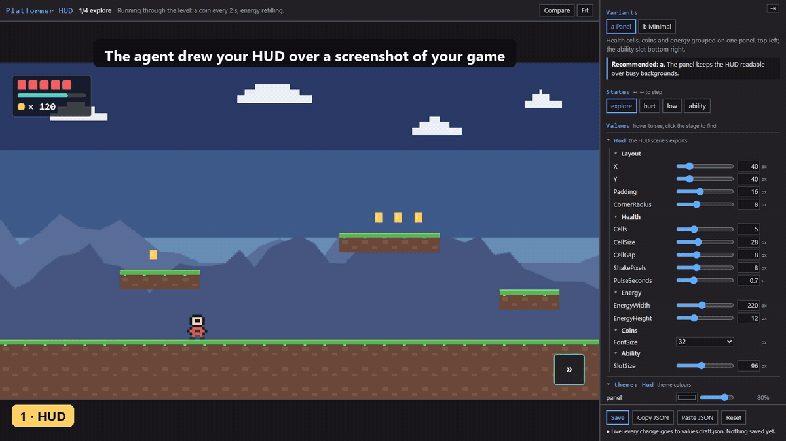

# game-ui-proof

**Does this sound like you?** You have your agent create some UI for you. It creates something. You don't like it. "Change this" you say, "not like this, i meant like this!" you say, "make this bigger, smaller, BETTER". 3 hours later and millions of tokens later, you have something that slightly resembles what you wanted. If that does sound like you, then boy do I have some good news for you.

**Tune your game's UI in the browser before your AI agent builds it.** The agent draws the proposal over a real screenshot of your game at its real resolution, with a panel of sliders and colour pickers. You tune it and press Save. The `values.json` it writes is the spec, and a script applies it to your engine.

A [Claude Code](https://code.claude.com) plugin for game developers (one skill, `ui-preview`). Works with any engine; reads and writes Godot and Unity files, reads Unreal DataTables.



**[Try the live demo](https://thomas-ratz.github.io/game-ui-proof/)**: four previews to tune in your browser, nothing to install. (No server there, so Save copies the JSON instead of writing a file.)

<!-- TODO before release: a clip of a game running with the applied values. -->

## Why

Agents are bad at visual tweaking: "move it 2 px left", "a bit less orange", one round trip each. Game UI makes it worse: states (low health, focused, night), transitions, pixel fonts, a theme in an engine file. game-ui-proof turns that into one loop:

1. **The agent builds a preview**: an HTML page drawing the HUD, menu or effect at the game's resolution over a real screenshot, using the game's own fonts, art and theme values, with every state and 2–4 design variants.
2. **You tune it** in a side panel; hover any value to see what it changes on the stage, click the stage to find the values behind a spot, hold Space to compare with the saved values, and press Z to zoom to real size. Every change is saved as a draft the agent can read; **Save** writes `values.json`, the approved spec.
3. **A review sheet** (`sheet.png`) shows every state and variant side by side, rendered by headless Chrome.
4. **The agent builds from the spec.** `apply_godot.py` / `apply_uss.py` write the values into your theme and script defaults (dry run first), and every number becomes an editor-exposed property: no magic numbers.

## Install

Requires Claude Code (it needs a shell, a browser and your files; it won't work as an uploaded claude.ai skill), Python ≥ 3.8 with Pillow ≥ 10.1 (for the sheet), and Chrome, Edge or Chromium.

In Claude Code:

```
/plugin marketplace add thomas-ratz/game-ui-proof
/plugin install game-ui-proof@game-ui-proof
```

Then ask Claude for a preview of a UI element in your game, or run `/game-ui-proof:ui-preview health bar`.

Without the plugin system, copy `skills/ui-preview/` to `~/.claude/skills/ui-preview/` (all projects) or `<your project>/.claude/skills/ui-preview/`.

## What's inside

| Path | |
|---|---|
| `skills/ui-preview/SKILL.md` | The workflow Claude follows |
| `…/references/kit.md` | Page format, panel specs, saving, `serve.py`, `shots.py` |
| `…/references/engines.md` | Godot, Unity, Unreal, web: readers, appliers, screenshots |
| `…/assets/kit/` | The kit Claude copies into your project (`docs/mockups/kit/`) |
| `…/assets/template/`, `godot/`, `unity/`, `unreal/` | Example preview pages; `godot/game_shots.gd` takes backdrops |
| `examples/` | Fake Godot, Unity and Unreal projects the example pages run in (`python examples/setup.py`) |
| `docs/demo/` | The live demo's previews and index (`build_site.py`), the tour video (`record.py`) |

| Engine | Reads into the panel | Writes the spec back |
|---|---|---|
| Godot 4 | Theme `.tres` (colours, font sizes, StyleBoxFlat/Texture) | Theme entries; C# `[Export]` and GDScript `@export` defaults |
| Unity | USS custom properties; ScriptableObject `.asset` fields | USS custom properties |
| Unreal | DataTable exported to JSON or CSV | By hand / re-import |
| Anything else | Values typed into the page | By hand |

## Security

`serve.py` binds to 127.0.0.1, refuses requests whose `Host` isn't itself (DNS rebinding), accepts saves only as JSON from pages it served (no cross-site writes), and only writes `values.json` / `values.draft.json` inside your previews folder. Treat `values.draft.json` as user input. `python skills/ui-preview/assets/kit/test_serve.py` checks these rules.

## License

[MIT](LICENSE) © 2026 Thomas Ratzicha
